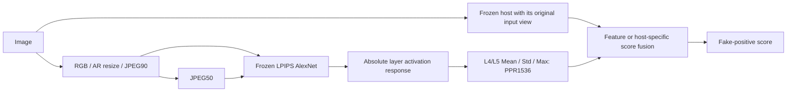

# PPA: Perceptual Perturbation-Based Activation for Generalizable AI-Generated Image Detection

**Unpublished release candidate — not yet a formally reproducible release.**
Intended repository: <https://github.com/kkgan406/PPA>. Final manuscript, authors,
venue, DOI, approved citation and project license await author confirmation; none is invented.

Start with the [Phase5 freeze and author review](docs/phase5-author-review.md),
[asset readiness](docs/phase5-asset-readiness.md),
[current four-host readiness report](docs/release-readiness.md),
[current paper/code author checklist](docs/phase5-paper-checklist.md),
[public host matrix](docs/public-host-support.md), and [blockers](docs/release-blockers.md).
Historical [phase1](docs/delivery.md) and [phase2](docs/phase2-release-audit.md)
audits and measured evidence remain available.

The paper evaluated seven hosts. This repository focuses on four representative
hosts: CLIP-L/14 and DINOv2 (general-purpose pretrained), CO-SPY and Effort
(dedicated AIGI detectors). Other paper experiments remain historical evidence;
they are outside the public runtime/configuration scope.

## Quick Start

Core environment: Python3.10.20, exact versions in `requirements.txt`.
The example asset paths below are prerequisites, not bundled data or weights.

```bash
python -m venv .venv
source .venv/bin/activate
python -m pip install -r requirements-dev.txt
python -m pip install --no-deps -e .
python scripts/motivation.py --help
python scripts/main_results.py --help
```

Install the documented official torchvision AlexNet checkpoint explicitly once;
LPIPS0.1.4 packages its v0.1 learned weights. Extraction verifies both full hashes:

```bash
python -c 'from torchvision.models import alexnet, AlexNet_Weights; alexnet(weights=AlexNet_Weights.IMAGENET1K_V1)'
```

Optional CLIP/DINOv2 raw interfaces need `requirements-hosts.txt`, exact external
assets/code and the original frozen native head. CLIP is limited public raw
verified; the original DINOv2 snapshot remains blocked by its source pin.
CO-SPY/Effort use bound caches; public raw adapters are absent. No fresh online
install/download reproduction is claimed; see [verification](docs/verification.md).

## Motivation and Overview

PPA is the complete active forensic framework. **PPR** (Perceptual Perturbation
Response, singular) is the evidence from a controlled perturbation. PPA integrates
that evidence through feature or score fusion with a frozen existing host.



For each ordered layer, `R[T,l](x)=abs(F_l(x)-F_l(T(x)))`. PPR uses raw post-ReLU
AlexNet features after official LPIPS v0.1 input scaling: no channel normalization
or learned perceptual-distance weights. The Motivation scalar is an **equal mean
of five layer means**. The structured1536D vector uses L4/L5 (256 channels each),
population std, order `Mean_L4,Mean_L5,Std_L4,Std_L5,Max_L4,Max_L5`.

Canonicalization is EXIF/RGB, bicubic AR long512, isotropic min64, then decoded
JPEG90/subsampling2. Extreme aspect ratios can exceed512 after the safeguard.
Q50/subsampling2 recodes this Q90 base. Blur is torchvision kernel5/sigma1;
noise is CPU torch Gaussian sigma.03, seed42 keyed by original sample_id. No
feature padding/resizing or square stretching is introduced in the PPR branch.

## Dataset Preparation

Obtain licensed images independently. GenImage's known official repository is
[Andrew-Zhu/GenImage](https://github.com/Andrew-Zhu/GenImage). An authoritative
CommGen15 download/version endpoint is still TODO; no substitute URL is supplied.

1. Obtain the owner's approved **exact frozen manifests** and actual dataset
   version/source. Local portable drafts are validated, but not released yet.
2. Preserve original image IDs, content SHA256, labels, domains, row membership and
   source splits. Relocate only paths to your licensed local files; paths resolve
   relative to the CSV. Never regenerate extension IDs from their new path.
3. Use real=0/fake=1; source-only SD1.4 TRAIN/VAL; `dataset=source/genimage/commgen15`
   and public `split=train/val/test`. Original split strings remain in `source_split`.
4. Verify file-byte hashes. Keep repeated target observations and original domain
   spelling/case. Source TRAIN/VAL content leakage is rejected.

See [manifest schema example](examples/data_manifest.example.csv),
[exact release plan](docs/manifest-release-plan.md), and
[dataset protocol audit](docs/dataset-protocol-audit.md). The example's TODO hashes
are intentionally invalid until replaced; a fresh scan or matching count does not
recreate the formal split.

| Frozen scope | Observations | Interpretation |
| --- | ---: | --- |
| Source TRAIN / VAL | 12,398 / 800 | SD1.4 only, disjoint;6199/class TRAIN and400/class VAL |
| Motivation / original GenImage6 | 75,991 | Original six domains, current source-content-disjoint |
| Historical GenImage Macro-8 | 99,991 | Includes SD1.4 source family and11,999 TRAIN-overlap observations |
| GenImage Macro-7-unseen | 87,991 | Entire SD1.4 domain excluded; zero current source TRAIN/VAL overlap |
| CommGen15 | 66,785 | Frozen fifteen-domain observations, including original content repetitions |

Macro AP means equal mean of unrounded generator AP; pooled AP is separate.
Macro-8 is not strictly all-OOD. Per-image content-disjoint evaluation is a
third scope and can leave an unestimable single-class group; it is not Macro-7.
Unknown host pretraining overlap and historically observed OOD targets remain
limitations. No split or formal metric was changed during release finalization.

## Checkpoint Acquisition

Use exact assets and pinned official instructions in the
[host provenance matrix](docs/host-reproducibility-matrix.md). The
[four-host asset inventory](docs/evidence/four-host-checkpoint-inventory.csv) gives actual
full SHA256 and lineage; [LPIPS hashes](docs/cache-format.md) are separate.

Official pretrained bases can be obtained under their upstream terms. Original
source-only native LR and frozen fusion heads are separate project assets: approved public endpoints are **TODO**. Arbitrary upstream
released detectors/heads cannot substitute for them. No weights are bundled;
model availability is distinct from redistribution permission.

## A. Core PPA Reproduction

Core scope is training-free Motivation and the standalone PPR-only classifier.
The frozen definitions and original data protocols above apply to both.

### Motivation Reproduction

Use the frozen independent GenImage6 single-split manifest:

```bash
python scripts/motivation.py --dataset data/motivation.csv --perturbation jpeg --output-dir outputs/motivation-jpeg --visualize 1
```

Replace `jpeg` with `blur` or `noise` for their fixed protocols. Original source-VAL
orientations are blur=-1/JPEG=-1/noise=+1 across views, not test-selected signs.
Outputs: per-image raw global/five-layer responses, label/domain/ID/hash, ROC-AUC,
metadata and optional raw maps/PNG. Archived reference AUCs and cache replay
provenance are in [evidence](docs/evidence/motivation-historical-replay.csv);
no paper-result constant is embedded in evaluation code.

### PPR-only Reproduction

```bash
python scripts/extract.py --dataset data/experiment.csv --output cache/ppr.npz
python scripts/ppr_only.py --dataset data/experiment.csv --cache cache/ppr.npz --output-dir outputs/ppr-only
```

The combined manifest supplies source TRAIN/VAL and target TEST. Existing
reproduction code fits only a source TRAIN StandardScaler + balanced LR;
source VAL selects C=.01/.1/1/10 by AP/ACC/AUC/smaller C. No TRAIN+VAL refit,
OOD tuning or host training; threshold is fixed margin>=0. Standalone uses the
full-fit PPR head, not the five-fold ensemble used by some score routes.
These fitting commands document the original workflow; Phase3 did not rerun
formal fitting or train a new model. Unit tests use disposable interface fixtures.

## B. Four-Host Integration

Only `CLIP`, `DINOv2`, `CO-SPY`, `Effort` are valid `--host` values.
Supply the exact original bound embeddings/native logits and PPR through the
[cache contract](docs/cache-format.md). CO-SPY native comparison additionally requires the original saved FP32
`native_probability` array in its bound cache; a logit-only cache is rejected for
this comparison rather than silently re-ranked. Both routes evaluate GenImage and
CommGen15 from the supplied target splits, without OOD-based route selection.

### Feature Fusion

All four retained feature routes use original frozen embeddings concatenated
with PPR1536 -> source TRAIN StandardScaler + balanced LR; source VAL selects C.
Effort's original FP32 inference/FP64 C-selection remains intact.

```bash
python scripts/main_results.py --dataset data/experiment.csv --cache cache/CLIP-ppr.npz --host CLIP --fusion feature --output-dir outputs/CLIP-feature
```

### Score Fusion

CLIP/DINOv2/CO-SPY preserve native logits + five-fold held-out PPR TRAIN logits
-> source-only scaler/LR; VAL/TEST PPR is the fold mean. Effort preserves raw
additive full-fit PPR, source-VAL alpha selection and **source-VAL maximum-BA
threshold**. Score fusion is not uniformly LR. Other target thresholds stay >=0.

```bash
python scripts/main_results.py --dataset data/experiment.csv --cache cache/CLIP-ppr.npz --host CLIP --fusion score --output-dir outputs/CLIP-score
```

With four approved caches named by the exact CLI host, reproduce all eight
routes in new output directories (these commands fit source-only fusion heads,
never the frozen Host; this scope audit did not refit formal heads):

```bash
for host in CLIP DINOv2 CO-SPY Effort; do
  for fusion in feature score; do
    python scripts/main_results.py --dataset data/experiment.csv --cache "cache/${host}-ppr.npz" --host "$host" --fusion "$fusion" --output-dir "outputs/${host}-${fusion}-all"
  done
done
```

### Four-Host Support Matrix

| Host | Public raw inference | Cache reproduction | Checkpoint requirements | License restrictions | Known blockers |
| --- | --- | --- | --- | --- | --- |
| CLIP-L/14 (`CLIP`) | Verified on limited real observations | Feature / Score verified | Exact official base + original native LR/fusion heads | PPA grant undecided; exact model/head terms separate | Approved native/fusion asset acquisition missing |
| DINOv2 | Blocked for original snapshot | Feature / Score verified | Exact original snapshot/ViT-B14 weights + native/fusion heads | Exact code/model grant review required | Original upstream source pin unresolved; exact assets unavailable to a fresh public user |
| CO-SPY | Blocked: public raw adapter absent | Feature / Score verified | Original multi-component assets + fusion heads + saved native probability ranks | MIT source observed; model/component terms separate | Public raw wrapper and approved exact asset/producer acquisition |
| Effort | Blocked: public raw fidelity adapter absent | Feature / Score verified | Exact official detector + frozen PPR/feature heads | **CC BY-NC 4.0** noncommercial restriction; bundled terms need review | Public fidelity wrapper, asset clearance/acquisition; auxiliary-only load caveat |

“Public” means candidate source, not legal clearance or complete reproduction.
Archive raw checks do not upgrade public support. [Full matrix](docs/public-host-support.md)
reports checkpoints/authorization and verified scope. Optional raw extraction via
`scripts/extract.py --host CLIP --host-config configs/clip.local.yaml` also needs
`--dataset`/`--output`; [local YAML keys](docs/cache-format.md) are mandatory.
No complete third-party repository or replacement detector is copied.

## C. Full Paper Results

The full paper experiment scope contains **seven Hosts**; this repository exposes
only the four representative integrations above. CLIMP, C2P-CLIP and AIDE remain
outside the frozen public runtime scope. Their archived formal numbers, including
negative gains, are preserved in historical audits; they are not active public
reproduction commands. See the [historical seven-host audit](docs/phase2-host-reproducibility-matrix.md)
and [dataset protocol](docs/dataset-protocol-audit.md).

No author-approved final manuscript was located. Final equations/table references,
result lineage and the seven-host paper wording require the
[author consistency checklist](docs/phase5-paper-checklist.md). Limited/cache
validation does not establish full paper reproduction. No DOI or citation is inferred.

## Outputs and Verification

| Entry | Outputs |
| --- | --- |
| Motivation | `responses.csv`, `metrics.csv`, `metadata.json`, optional raw maps/PNG |
| PPR-only | `model.joblib`, source selection/seal/digest, predictions, overlap audit, metrics and metadata |
| Main Results | Same supervised artifacts; optional OOF ledger; additionally `native_metrics.csv` and `native_vs_ppa.csv` |

`metrics.csv` keeps original PPA generator/macro/pooled AP, ACC, ROC-AUC (`auc`),
BA on[0,1], with threshold/source and evaluation range. `native_vs_ppa.csv` pairs
native and augmented metrics for each identical dataset/scope/range and records
signed `delta_ap/acc/auc/ba`; **all negative gains are retained**. Predictions bind
ID/hash/label/domain to scores, including native logit/prediction in main runs.
Native Effort uses strict >0; its augmented score uses >=source-VAL threshold.
CO-SPY native AP/AUC preserve original saved FP32 sigmoid ranking (including saturation
ties); canonical ACC/BA use raw logit>=0 as in the unified tables. No threshold,
coefficient, scaler or formal result is changed by reporting.

Output directories must be new/empty. Cache provenance is a producer declaration,
not independent proof of a producer. Source/code/asset hashes are recorded.

```bash
python -m pytest -q tests
python scripts/main_results.py --help
python scripts/extract.py --help
```

[Verification](docs/verification.md) separates synthetic interface checks, real
cached route replay, real-data CLI subsets and limited historical raw checks.
Fresh online installation, missing public assets and final paper agreement are
not asserted. The [scope report](docs/four-host-release-scope.md) lists excluded
files and exact preservation checks.

## Known Limitations

Final manuscript sign-off is absent; manifests/asset hosting/model permissions
and the final extension MSM lineage are unresolved. DINOv2's original source
snapshot has byte hashes but no recovered upstream commit. Dedicated public raw
adapters remain absent. The candidate is **not ready for formal reproducible public release**; see the
[typed blocker register](docs/release-blockers.md).

## Third-Party Licenses and Acknowledgements

PPR uses LPIPS/torchvision AlexNet. CO-SPY has an observed MIT source license;
Effort README declares **CC BY-NC 4.0**. CLIP/DINOv2 code/model-specific terms
must be reviewed at the exact asset revision. Code declarations do not clear
model/data redistribution. No third-party source tree, checkpoint or dataset is
bundled. The PPA LICENSE remains undecided. See [license audit](docs/licenses.md).

## Citation

AUTHOR DECISION REQUIRED: authors supply the approved final paper link and BibTeX. No DOI, venue,
year, authorship or published citation is guessed.
